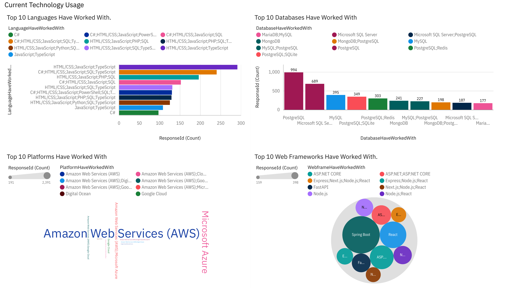
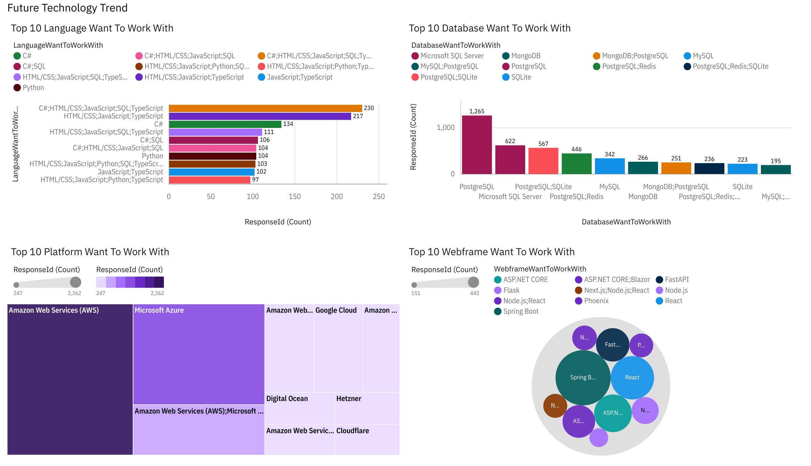
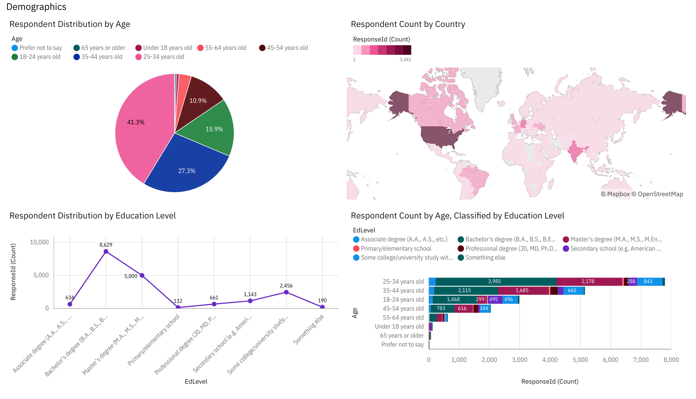

# Developer Technology Trends: IBM Data Analyst Capstone Project

An end-to-end data analysis of the **Stack Overflow Developer Survey** to find which programming languages, databases, platforms and tools are in demand now and which are rising. Completed for the **IBM Data Analyst Professional Certificate** as part of the NPower Canada AI and Data Analytics Program.

**Author:** Oluwakanyinsola Ifeoluwa Adebanjo · [LinkedIn](https://www.linkedin.com/in/soladebanjo)

## Business scenario

As a data analyst at a global IT and business consulting firm, I collected and analysed data from job postings, a salary website and a developer survey to identify the skills the firm should hire and train for.

## Key findings

| Area | Current year (used) | Next year (wanted) |
|---|---|---|
| Languages | JavaScript (79%), SQL (67%), HTML/CSS (66%) | JavaScript, SQL, TypeScript; **Go and Rust** enter the top 10 |
| Databases | PostgreSQL (61%), MySQL (45%), SQLite (37%) | PostgreSQL (65%); **Redis** rises from #6 to #2 |
| Cloud platforms | AWS (58%), Azure (36%), Google Cloud (29%) | Same leaders; Cloudflare and Hetzner gain interest |
| IDEs | Visual Studio Code (80%) | Visual Studio Code (72%); IntelliJ IDEA overtakes Visual Studio |

- **Job postings:** Washington DC (5,316), Detroit (3,945) and Seattle (3,375) have the most postings of the 7 cities analysed.
- **Salaries:** Swift ($130,801), Python ($114,383) and C++ ($113,865) have the highest average salaries.
- **Respondents:** 69% are aged 25 to 44, and a bachelor's degree is the most common education.

## Dashboard (IBM Cognos Analytics)

| Current Technology Usage | Future Technology Trends | Demographics |
|---|---|---|
|  |  |  |

Full export: [Developer_Survey_Dashboard.pdf](dashboard/Developer_Survey_Dashboard.pdf)

## Final presentation

[Data Analyst Capstone Project Report (PDF)](presentation/Data%20Analyst%20Capstone%20Project%20Report.pdf)

## Project workflow

| Stage | What I did | Notebooks |
|---|---|---|
| 1. Data collection | Called a REST API with `requests`, scraped a web page with BeautifulSoup, explored the survey dataset | [1-data-collection](notebooks/1-data-collection) |
| 2. Data wrangling | Removed duplicates, imputed missing values, normalised compensation (min-max, z-score, log), encoded categories | [2-data-wrangling](notebooks/2-data-wrangling) |
| 3. Exploratory data analysis | Distributions, IQR outlier removal, correlation analysis | [3-exploratory-data-analysis](notebooks/3-exploratory-data-analysis) |
| 4. Data visualization | Histograms, box, scatter, bubble, pie, stacked, line and bar charts, including SQL queries on SQLite | [4-data-visualization](notebooks/4-data-visualization) |
| 5. Dashboard | Three-tab IBM Cognos Analytics dashboard | [dashboard](dashboard) |
| 6. Presentation | Findings, implications and conclusions | [presentation](presentation) |

## Data

- **Stack Overflow Developer Survey subset** (18,845 responses, 114 columns), released under the [Open Database License](https://opendatacommons.org/licenses/odbl/). The raw CSV is not included because of its size.
- [`data/job-postings.xlsx`](data/job-postings.xlsx): job postings by location, collected through the Jobs API
- [`data/popular-languages.csv`](data/popular-languages.csv): average salary by programming language, collected by web scraping

## Tools

Python (pandas, NumPy, matplotlib, seaborn, requests, BeautifulSoup, openpyxl), SQL (SQLite), Jupyter, IBM Cognos Analytics, PowerPoint
